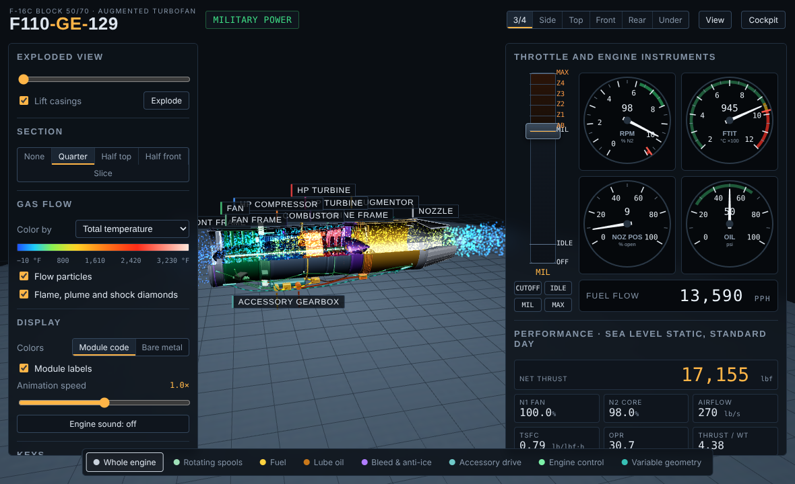
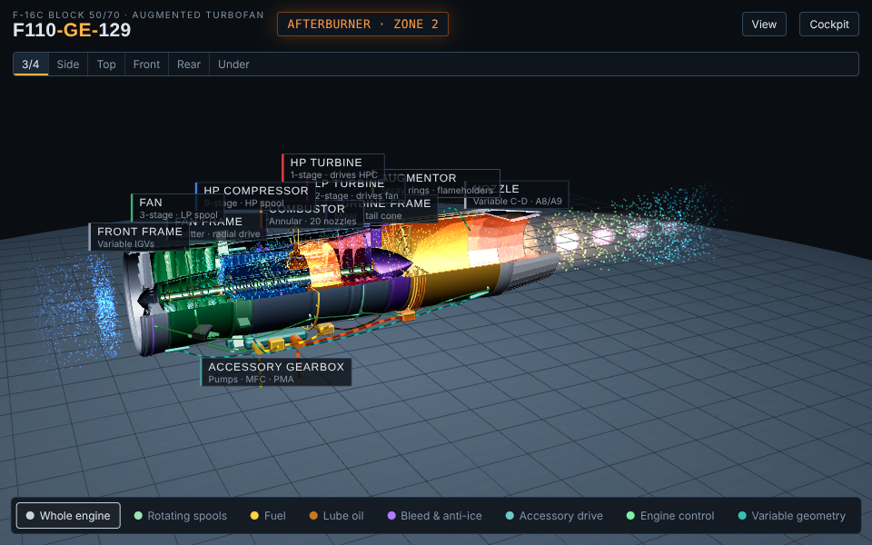
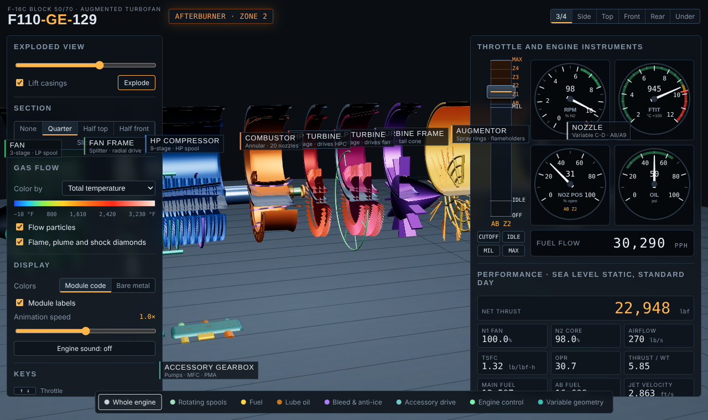
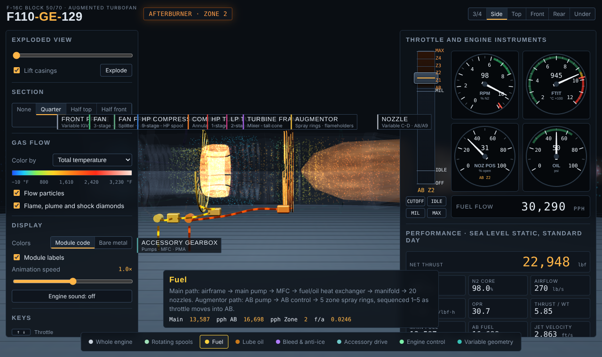
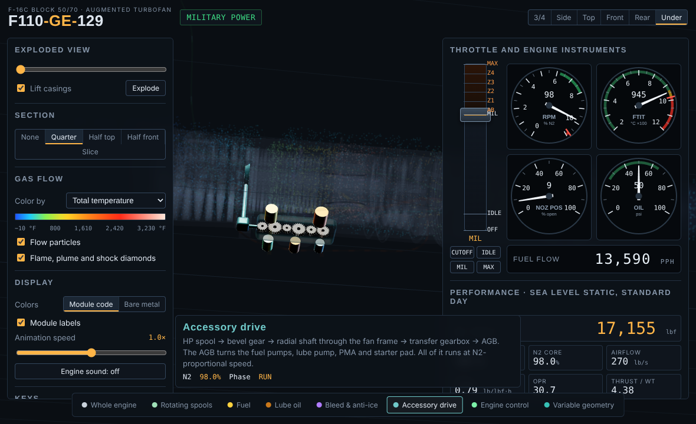

# GE F110-GE-129 Operating Model

An interactive 3D model of the General Electric F110-GE-129 afterburning turbofan, the engine in the F-16C Block 50/70. It runs in a web browser. The engine is driven by a calibrated Brayton-cycle model: move the throttle from cutoff through idle and MIL to max afterburner, and the spools, gas flow, flame, nozzle and cockpit gauges respond.

## Run it

Open `index.html` in a modern desktop browser (Chrome, Edge, Firefox or Safari). Nothing needs installing or building. The page loads [three.js](https://threejs.org) 0.160.0 from the jsDelivr CDN, so it needs an internet connection.

## Features

- **Engine geometry.** 3-stage fan, 9-stage HP compressor, annular combustor with 20 fuel nozzles, 1-stage HP turbine, 2-stage LP turbine, mixer, augmentor and a variable convergent-divergent nozzle. The LP and HP spools counter-rotate.
- **Throttle.** Cutoff, idle, part power, MIL and afterburner zones 1–5. From cutoff, the start sequence motors the engine on the JFS, lights off at 20% N2 and accelerates to idle.
- **Gas flow.** About 9,000 particles. Color them by total temperature, total pressure, velocity, or core/bypass stream. The combustor flame, afterburner flame, exhaust plume and shock diamonds scale with power.
- **Exploded view.** Modules separate along the engine axis, and the casings can lift off.
- **Section views.** Quarter cutaway, half (top or front), or a cross-section slice you can move along the engine.
- **Systems isolation.**
  - Rotating spools
  - Fuel, main and afterburner
  - Lube oil
  - Bleed and anti-ice
  - Accessory drive
  - Engine control (FADEC)
  - Variable geometry and nozzle actuation
- **Cockpit instruments.** F-16-style RPM, FTIT, nozzle-position and oil gauges, plus a fuel-flow counter, a thrust-vs-throttle curve and a live gas-path station table (stations 0–9).
- **Part cards.** Click any part for its function, typical material, specs and live values.
- **Engine sound.** Synthesized with Web Audio; turn it on from the panel.

## Model accuracy

Model results at sea-level static, standard day:

| Setting | Thrust | Fuel flow | FTIT | Nozzle |
|---|---|---|---|---|
| Idle (70% N2) | ~944 lbf | 1,626 pph | 419 °C | 100% |
| MIL | 17,155 lbf | 13,590 pph | 943 °C | 9% |
| Max AB | 29,500 lbf | 52,340 pph | 945 °C | 59% |

- MIL and max-AB thrust are calibrated to match published figures. Airflow (270 lb/s), overall pressure ratio (30.7) and bypass ratio (0.76) are also published values.
- FTIT, nozzle position and fuel flow are computed by the model. They fall inside the GE-129 operating limits listed in [the spec sheet](docs/F110-GE-129_Spec_Sheet.md).
- Values between those points, blade counts and the five afterburner zones are representative. They are not GE data.

This is an educational visualization built from public sources. It is not a maintenance or flight reference.

## Controls

| Input | Action |
|---|---|
| Drag / scroll / right-drag | Orbit / zoom / pan |
| Click a part | Open its info card |
| ↑ ↓ | Throttle |
| I, M, A | Idle, MIL, max AB |
| X | Cutoff or start |
| E | Explode or assemble |
| C | Cycle section modes |
| 0–7 | Isolate a system |

## Screenshots

| | |
|---|---|
|  |  |
|  |  |

## License

MIT. See [LICENSE](LICENSE).
